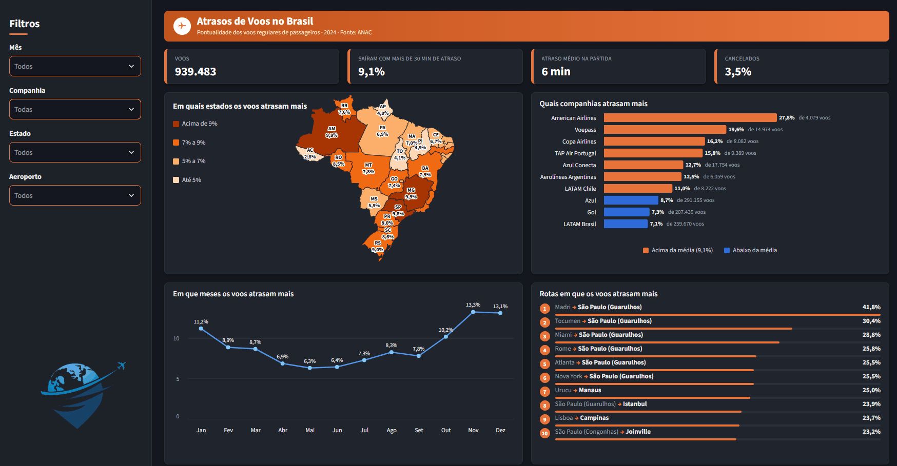
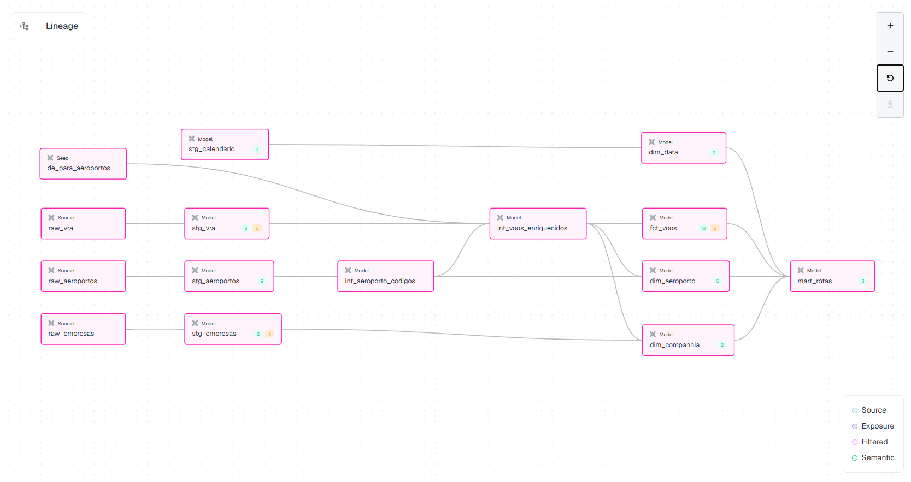

# ✈️ Atrasos de Voos no Brasil · 2024

**Quais estados, companhias, meses e rotas mais atrasam no Brasil?**
Pipeline de dados completo com dados abertos da ANAC: ingestão em Python, modelagem com dbt no **Snowflake** e dashboard em **Streamlit in Snowflake**.



---

## 📊 Principais resultados (voos regulares de passageiros, 2024)

| Indicador | Valor |
|---|---|
| Voos analisados | **939.483** |
| Saíram com mais de 30 min de atraso | **9,1%** |
| Atraso médio na partida | **6 min** |
| Cancelados | **3,5%** |

- **Fim de ano é o pior período:** novembro (13,3%) e dezembro (13,1%) concentram os maiores atrasos; maio (6,3%) é o mês mais pontual.
- **As grandes ficam abaixo da média:** LATAM Brasil (7,1%), Gol (7,3%) e Azul (8,7%), que juntas somam mais de 750 mil voos.
- **Companhias com poucos voos no Brasil atrasam mais:** American Airlines chega a 27,8% (de 4.079 voos). Por isso o dashboard mostra sempre o **% e a base** ("27,8% de 4.079 voos").
- **Rotas internacionais lideram o ranking**, com voos para e de Guarulhos no topo.

> Atraso = partida real mais de 30 minutos depois da prevista, o mesmo corte usado pela ANAC. Cancelados ficam fora da base do % de atrasos.

---

## Arquitetura

```
ANAC (VRA 2024) + OurAirports
        │  Python
        ▼
  Stage interno  ──►  COPY INTO  ──►  dbt (staging → intermediate → marts)  ──►  Streamlit
  (Snowflake)         (RAW)           testes + Elementary                        in Snowflake
```

| Camada | Ferramenta | O que faz |
|---|---|---|
| Ingestão | Python | Baixa os arquivos da ANAC e envia para o stage interno (autenticação por par de chaves) |
| Armazenamento | Snowflake (stage + RAW) | Recebe os arquivos e carrega com `COPY INTO`, guardando o nome do arquivo de origem |
| Processamento | Snowflake (warehouse XSMALL) | Motor SQL com auto-suspend e resource monitor para controlar o custo |
| Transformação | dbt Core + dbt-snowflake | Modelagem em camadas, testes e documentação |
| Qualidade | Elementary | Relatório de testes e lineage |
| Visualização | Streamlit in Snowflake | Dashboard interativo com mapa, rankings e filtros |

### Star Schema

- **Fato:** `fct_voos` (uma linha por voo, incremental)
- **Dimensões:** `dim_aeroporto`, `dim_companhia`, `dim_data`
- **Agregado:** `mart_rotas` (rota × companhia × mês, alimenta o dashboard)



**Recursos do Snowflake explorados:** stage interno, `COPY INTO`, Time Travel, `UNDROP`, zero-copy clone, Query Profile, streams, tasks e dynamic tables.

---

## Ingestão

A ingestão é feita por scripts Python em `ingestion/` e por SQL em `sql/`, executados **nesta ordem**:

| # | Script | O que faz |
|---|---|---|
| 1 | `sql/01_setup.sql` | Cria o warehouse XSMALL com auto-suspend, o resource monitor, o database `VOOS`, os schemas e a role `VOOS_DEV` |
| 2 | `ingestion/gerar_chaves.py` | Gera o par de chaves para autenticação no Snowflake (a privada fica em `keys/`, fora do Git) |
| 3 | `ingestion/baixar_vra.py` | Baixa os 12 arquivos mensais do VRA de 2024 do portal de dados abertos da ANAC |
| 4 | `sql/02_stage.sql` | Cria o stage interno e os formatos de arquivo (separador, cabeçalho, encoding) |
| 5 | `ingestion/enviar_stage.py` | Envia os arquivos para o stage com `PUT` (compacta em `.gz` e pula o que já foi enviado) |
| 6 | `sql/03_carga.sql` | Cria as tabelas RAW e carrega os arquivos com `COPY INTO` |
| 7 | `sql/04_automacao.sql` | Task mensal, stream e dynamic table (testados e deixados suspensos) |

```
uv run python ingestion/gerar_chaves.py
uv run python ingestion/baixar_vra.py --ano 2024
uv run python ingestion/enviar_stage.py
```

**Organização no stage:**

```
@VOOS.RAW.STG_VOOS/
├── vra/ano=AAAA/mes=MM/       # CSV mensal do VRA (.gz)
└── referencias/
    ├── airports/              # aeroportos do OurAirports
    └── empresas/              # cadastro de empresas aéreas da ANAC
```

- **Idempotente:** se o arquivo do mês já foi baixado ou enviado, ele é pulado (use `--force` para baixar de novo).
- **Tudo como texto na RAW:** a tipagem fica a cargo da camada de staging do dbt.
- **Rastreável:** cada linha guarda o arquivo de origem (`METADATA$FILENAME`) e a hora da carga.

---

## ✅ Qualidade e validação

- **51 testes dbt em todas as camadas:** `unique`, `not_null`, `relationships`, `accepted_values`, `accepted_range`, `unique_combination_of_columns` e testes singulares (ex.: soma do `mart_rotas` igual à fato; chegada depois da partida). Problemas conhecidos da fonte ficam como `warn`, visíveis sem travar o pipeline.
- **Elementary:** relatório completo de testes e lineage em 👉 **[natmartines.github.io/voos-anac/elementary](https://natmartines.github.io/voos-anac/elementary/)**
- **Validação contra os números oficiais da ANAC** (janeiro de 2024, voos N + I):

| | Projeto | ANAC | Diferença |
|---|---|---|---|
| Etapas previstas | 79.022 | 78.448 | **0,7%** |
| % cancelados | 5,22% | 5,17% | +0,05 p.p. |

Nas rotas comparadas, as etapas previstas **batem exatamente**. Detalhes em [`analyses/validacao_anac.md`](analyses/validacao_anac.md).

---

## 🧭 Decisões principais

- **Recorte oficial:** só voos regulares de passageiros (tipos N + I), igual ao indicador da ANAC.
- **De-para de aeroportos:** alguns códigos da ANAC não existem no OurAirports (aeroportos que mudaram de código); um seed faz a ponte.
- **% sempre recalculado a partir das somas**, nunca pela média de percentuais.
- **Mínimo de voos nos rankings**, para amostras pequenas não aparecerem no topo por acaso.
- **Mapa por estado em vez de linhas de rotas:** testei arcos e linhas, mas centenas de rotas sobrepostas ficavam ilegíveis.
- **Filtros de Estado e Aeroporto pela origem do voo**, a mesma regra do mapa, para todos os gráficos contarem a mesma história.

Todas as decisões, dia a dia, estão em [`docs/decisoes.md`](docs/decisoes.md).

---

## 💰 Custo

O projeto inteiro custou **cerca de US$ 30** em créditos do período de teste do Snowflake (de US$ 400 disponíveis).

- Warehouse **XSMALL** com auto-suspend de 60 s e **resource monitor** limitando o consumo.
- O maior gasto veio do **app Streamlit aberto por horas** durante os ajustes de layout. Aprendizado: fechar o app quando não estiver usando e preferir cache (`st.cache_data`) para não consultar o warehouse a cada clique.

---

## 🤖 Uso de IA

Defini o layout, as regras de cálculo e os gráficos e, a partir dessas especificações, usei o **Claude Code** para gerar o código do dashboard. Depois, transformei esse padrão em **skills reutilizáveis**, versionadas no repositório:

| Skill | Para que serve |
|---|---|
| [`dashboard-streamlit-snowflake`](.claude/skills/dashboard-streamlit-snowflake/SKILL.md) | Padrão visual, regras de cálculo e armadilhas para criar dashboards em Streamlit in Snowflake |
| [`documentar-tabelas-dbt`](.claude/skills/documentar-tabelas-dbt/SKILL.md) | Gera a documentação dos modelos dbt em português (schema.yml, testes e dicionário) |

---

## ⚠️ Limitações

- Análise apenas de **2024**.
- O atraso é medido **na partida**, não na chegada.
- **30.942 voos** não têm partida prevista na fonte; para eles, a data do voo usa a partida real.
- A ANAC parece contar como cancelados alguns voos que aparecem como realizados no VRA (diferença de ~1 p.p. em algumas rotas).
- O app do Streamlit in Snowflake **não é público**: fica dentro da conta Snowflake. Por isso o resultado está no GIF acima.

---

## 🛠️ Tecnologias

`Python` · `uv` · `Snowflake` · `dbt` · `dbt_utils` · `Elementary` · `Streamlit` · `Altair` · `pandas` · `Git`

---

## ▶️ Como rodar

1. Crie uma conta no Snowflake e siga a ordem da seção **Ingestão**.
2. Instale as dependências e configure o `.env` (conta, usuário e caminho da chave privada):
```bash
   uv sync
```
3. Construa os modelos e rode os testes:
```bash
   cd voos_dbt
   uv run dbt deps
   uv run dbt build
```
4. Gere o relatório de qualidade:
```bash
   uv run edr report --profile-target voos
```

**Dashboard:** no Snowsight, crie um app Streamlit e envie os arquivos da pasta `app/` (`streamlit_app.py`, `brasil_estados.geojson`, `logo.png` e `.streamlit/config.toml`).

---

## Estrutura do repositório

```
voos-anac/
├── ingestion/           # scripts Python (chaves, download da ANAC, envio ao stage)
├── sql/                 # setup, stage, carga (COPY INTO) e automação
├── voos_dbt/            # projeto dbt
│   ├── models/
│   │   ├── staging/
│   │   ├── intermediate/
│   │   └── marts/
│   ├── seeds/           # de-para de códigos de aeroportos
│   ├── tests/           # testes singulares
│   └── macros/
├── analyses/            # exploração e validação com a ANAC
├── app/                 # dashboard Streamlit in Snowflake
├── docs/                # decisões, imagens e relatório Elementary (GitHub Pages)
└── .claude/skills/      # skills de IA usadas no projeto
```

---

## Fonte dos dados

- **VRA (Voo Regular Ativo):** ANAC, dados abertos, voos de 2024.
- **Percentuais de atrasos e cancelamentos (Resolução 218):** ANAC, usados na validação.
- **Cadastro de empresas aéreas:** ANAC, apenas colunas não pessoais.
- **Aeroportos e coordenadas:** [OurAirports](https://ourairports.com/data/) (domínio público).

Projeto pessoal de portfólio, feito com dados públicos. Não é um painel oficial da ANAC.

---

**Natália Martines** · [LinkedIn](https://www.linkedin.com/in/nathaliamartines) · [GitHub](https://github.com/NatMartines)